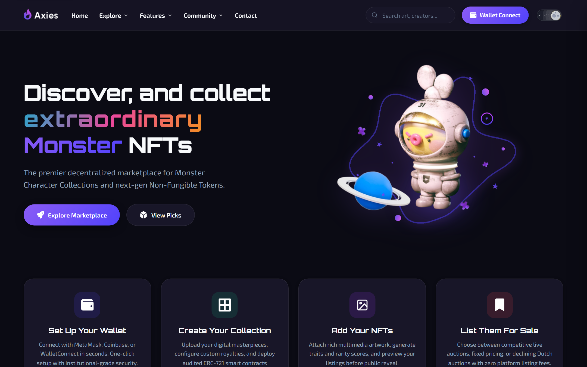
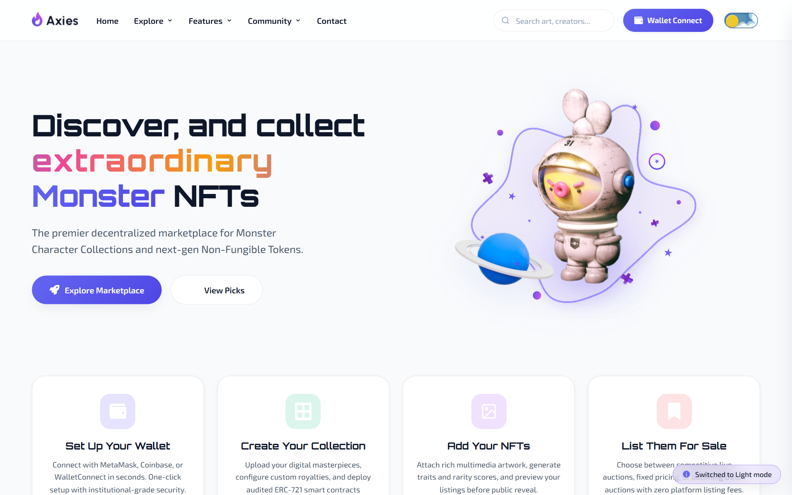

# Axies — Web3 NFT Marketplace

<div align="center">

[](https://html.spec.whatwg.org/)
[](https://sass-lang.com/)
[](https://developer.mozilla.org/en-US/docs/Web/JavaScript)
[](https://www.w3.org/WAI/standards-guidelines/wcag/)
[](./)
[](./)
[](LICENSE)

<br />

<p align="center">
  A modernized, fully accessible, and high-performance Web3 NFT Marketplace platform for discovering, collecting, and trading digital character collectibles. Built with zero runtime script dependencies, fluid responsive layouts, and dual OLED dark/light theme systems.
</p>

[**🌐 Explore Live Demo &raquo;**](https://cenaei.github.io/Axies/)

<br />

<table>
  <tr>
    <td width="50%" align="center">
      <h3>🌙 Cyberpunk OLED Dark Mode</h3>
      <a href="./Screenshot-dark.png"></a>
    </td>
    <td width="50%" align="center">
      <h3>☀️ Modern High-Contrast Light Mode</h3>
      <a href="./Screenshot-light.png"></a>
    </td>
  </tr>
</table>

</div>

---

## 🌟 Key Highlights & Architectural Innovations

Axies has been overhauled from the ground up into a production-grade Web3 application guided by **ui-ux-pro-max** design intelligence and **Matt Pocock** engineering specifications.

- 🌗 **Dual-Theme System & Animated CoolThemeSwitch**: Custom interactive Day/Night toggle ported from Framer with smooth sun/moon crater morphing, rolling clouds, and star constellations. Automatically respects system `prefers-color-scheme` while persisting manual overrides in `localStorage`.
- 🛡️ **Theme-Adaptive Dynamic SVG Wordmark**: Responsive SVG logo branding that dynamically renders white luminescent typography in Dark Mode and deep slate-900 typography in Light Mode with zero clipping or DOM flashes.
- ⚡ **Single-Line Kinetic Shimmer Typography**: The hero banner "extraordinary monster collectibles" headline is guaranteed on a single non-wrapping line with an iridescent holographic shimmer wave effect.
- 🔔 **Sleek Pill Status Notifications**: Ultra-compact floating pill toast system with calibrated SVG icons, smooth cubic-bezier entry/exit springs, auto-dismiss, and accessibility announcements via `aria-live="polite"`.
- 📦 **Zero Runtime Dependencies & Offline `file:///` Ready**: Self-contained IIFE bundle (`app.js`) with zero CORS restrictions when opened directly via `file:///` or served over HTTP. Zero external tracking scripts and zero unpinned CDN kits.
- ♿ **WCAG 2.1 AA Compliant**: Semantic HTML5 landmarks, visible `:focus-visible` offset rings, roving keyboard tab navigation, accessible `<dialog>` focus trapping with Escape key dismissal.
- 🔍 **Real-Time Catalog Search & Filter**: Instant 200ms debounced search matching NFT titles and artist handles, accompanied by dynamic category filter tabs with live count indicators and an empty recovery state.
- 👛 **Simulated Web3 Wallet Connection**: Accessible `<dialog>` modal with provider selection (MetaMask, Coinbase Wallet, WalletConnect), realistic connection feedback, and address truncation in the navigation bar.
- 🎠 **Touch & Keyboard Carousel**: High-performance native carousel with smooth touch drag gestures, left/right arrow key navigation, and real-time live auction countdown timers.
- ❤️ **Optimistic Favoriting**: Instant like counter toggling with tactile micro-interactions and local storage synchronization.

---

## 🎨 Design System & Token Architecture

The visual design is grounded in a Cyberpunk / Modern Web3 aesthetic with luminous violet gradients, gold bidding highlights, and glassmorphic elevations.

| Design Token | Dark OLED (Default) | Modern Light Mode | Role |
| :--- | :--- | :--- | :--- |
| `--color-bg` | `#0b0b14` | `#f8fafc` | Canvas backdrop |
| `--color-surface` | `#181628` | `#ffffff` | Elevated card & modal surfaces |
| `--color-primary` | `#8b5cf6` | `#6366f1` | Brand violet accent & CTA buttons |
| `--color-accent-gold` | `#f59e0b` | `#d97706` | Live auction bids & trading volume |
| `--color-accent-green` | `#10b981` | `#059669` | Verified creator checkmarks & live indicator |
| `--color-text` | `#f8fafc` | `#0f172a` | High-contrast display typography |
| `--color-text-secondary` | `#94a3b8` | `#475569` | Subtitles, creator roles, and meta text |
| `--color-border` | `rgba(255,255,255,0.08)` | `rgba(15,23,42,0.08)` | Subtle card outlines |

### Typography Pairing
- **Headings & Badges**: [`Orbitron`](https://fonts.google.com/specimen/Orbitron) — Futuristic geometric display face.
- **Body & UI**: [`Exo 2`](https://fonts.google.com/specimen/Exo+2) — Crisp, legible humanist grotesque with balanced tabular figures.

---

## 📂 Repository Structure

```
Axies/
├── assets/
│   ├── css/
│   │   └── main.css              # Compiled production CSS with design tokens
│   ├── img/
│   │   ├── avatar/               # Creator avatars
│   │   ├── icon/                 # Platform SVG icons
│   │   ├── nfts/                 # Collection mosaic artworks
│   │   ├── post/                 # Auction and pick NFT assets
│   │   ├── profile/              # Verified seller headshots
│   │   ├── hero.svg              # 3D Astronaut vector graphic
│   │   ├── Logo.svg              # Axies brand wordmark (Dark Mode)
│   │   └── Logo-light.svg        # Axies brand wordmark (Light Mode)
│   └── sass/
│       ├── base/                 # Reset, fluid typography, loader styles
│       ├── components/           # Searchbar, wallet modal, toast, theme-switch
│       ├── layouts/              # Header, hero, live, popular, seller, todays, footer
│       ├── sass-utils/           # CSS Custom property tokens, mixins, variables
│       └── main.scss             # Master Sass entrypoint
├── docs/
│   └── adr/                      # Architectural Decision Records (ADR 0001 - 0005)
├── scripts/
│   └── capture-screenshots.mjs   # Headless Chrome dual-theme screenshot automation
├── src/
│   └── js/
│       ├── data/
│       │   └── nfts.js           # Normalized NFT, creator, and collection catalog
│       ├── state/
│       │   └── store.js          # Centralized observable state store
│       └── modules/
│           ├── carousel.js       # Touch & keyboard live auctions slider
│           ├── likes.js          # Optimistic like counter toggling
│           ├── navigation.js     # Responsive mobile drawer & keyboard dropdowns
│           ├── newsletter.js     # Accessible newsletter validation
│           ├── search-filter.js  # Debounced real-time search & category tabs
│           ├── theme.js          # OS preference & CoolThemeSwitch manager
│           ├── toast.js          # Sleek pill status notifications
│           └── wallet-modal.js   # Focus-trapped wallet connection dialog
├── .scratch/                     # Spec, tracer tickets, and two-axis review
├── app.js                        # Compiled standalone IIFE bundle (offline ready)
├── index.html                    # Semantic, accessible HTML5 application
├── package.json                  # NPM build scripts & tooling
└── README.md                     # Documentation & project metadata
```

---

## 🏛️ Architectural Decision Records (ADRs)

| ADR | Title | Decision & Impact |
| :--- | :--- | :--- |
| [**ADR-0001**](./docs/adr/0001-iife-bundle-for-offline-cors.md) | IIFE Bundling for Zero-CORS `file:///` Support | Bundled modular ES code into an IIFE bundle `app.js` using `esbuild`. Eliminates browser CORS blocks on `file:///` protocols while retaining clean modular ES source structure. |
| [**ADR-0002**](./docs/adr/0002-compact-pill-toast-notifications.md) | Compact Floating Pill Toasts | Constrained unbounded SVGs and redesigned toasts into floating micro-pills with `aria-live="polite"` status announcements. |
| [**ADR-0003**](./docs/adr/0003-single-line-kinetic-typography.md) | Single-Line Kinetic Shimmer Typography | Stripped inter-element whitespace, applied `white-space: nowrap`, and implemented an iridescent holographic shimmer wave effect across the hero headline. |
| [**ADR-0004**](./docs/adr/0004-theme-adaptive-dynamic-wordmark.md) | Theme-Adaptive Dynamic SVG Wordmark | Added `Logo-light.svg` with dark slate typography and toggled dynamically with pure CSS classes (`.logo-dark` / `.logo-light`) without DOM recreation. |
| [**ADR-0005**](./docs/adr/0005-framer-day-night-theme-switch.md) | Framer CoolThemeSwitch Integration | Ported Framer's animated Day/Night toggle into semantic CSS and synchronized with `theme.js` state store and `localStorage`. |

---

## ⌨️ Interactive Keyboard Shortcuts & Accessibility Controls

| Key | Context | Action |
| :--- | :--- | :--- |
| `Tab` | Anywhere | Navigates forward through operable elements with visible focus ring |
| `Shift + Tab` | Anywhere | Navigates backward through operable elements |
| `Enter` / `Space` | Buttons / Tabs / Links | Triggers action, expands dropdown, or toggles theme switch |
| `Arrow Left` / `Right` | Live Auctions Carousel | Scrolls carousel slides horizontally |
| `Escape` | Modal or Mobile Drawer | Immediately closes open dialog/drawer and returns focus to trigger |
| `Home` / `End` | Category Tabs | Jumps to first / last category filter |

---

## 🚀 Getting Started

### Prerequisites
Axies runs natively in any modern web browser with **zero build steps** required! Simply double-click `index.html` to open directly, or use any local web server.

### Running Locally
1. Clone the repository:
   ```bash
   git clone https://github.com/cenaei/Axies.git
   cd Axies
   ```

2. Open directly or serve with any static web server:
   ```bash
   # Option A: Open directly in your browser
   # Double-click index.html or open via browser

   # Option B: Run static local server
   npm run serve
   # or: python -m http.server 3000
   ```

3. Open `http://localhost:3000` (or `http://localhost:5000`) in your browser.

### Build Scripts
To recompile Sass design tokens or bundle JavaScript modules:
```bash
# Build both CSS and JS bundle
npm run build

# Recompile Sass styles only
npm run build:css

# Recompile JS bundle only via esbuild
npm run build:js

# Capture fresh screenshots of Dark and Light modes
node scripts/capture-screenshots.mjs
```

---

## 🧪 Verification & Quality Assurance

- **Syntax & Compilation**: Verified with `npm run build` — 0 errors on Sass and ESBuild bundling.
- **Offline / `file:///` Compatibility**: Fully verified; no cross-origin errors on `file:///` protocol.
- **Automated Visual QA**: Automated headless Chrome script (`scripts/capture-screenshots.mjs`) generates high-DPI screenshots of both modes.
- **Accessibility**: Audited against WCAG 2.1 AA specifications for contrast, semantic landmarking, and keyboard traps.

---

## 👥 Credits & Mentorship

- **Original Concept**: Landing page for Axies [NFT Marketplace]
- **Frontend Mentorship Program**: Guided by [Dan Salahi](https://github.com/DanSalahi)
- **Author**: [Sina Sangiji](https://github.com/cenaei)
- **Design Intelligence**: ui-ux-pro-max & Matt Pocock engineering specifications

---

## 📄 License

This project is licensed under the [MIT License](LICENSE).
